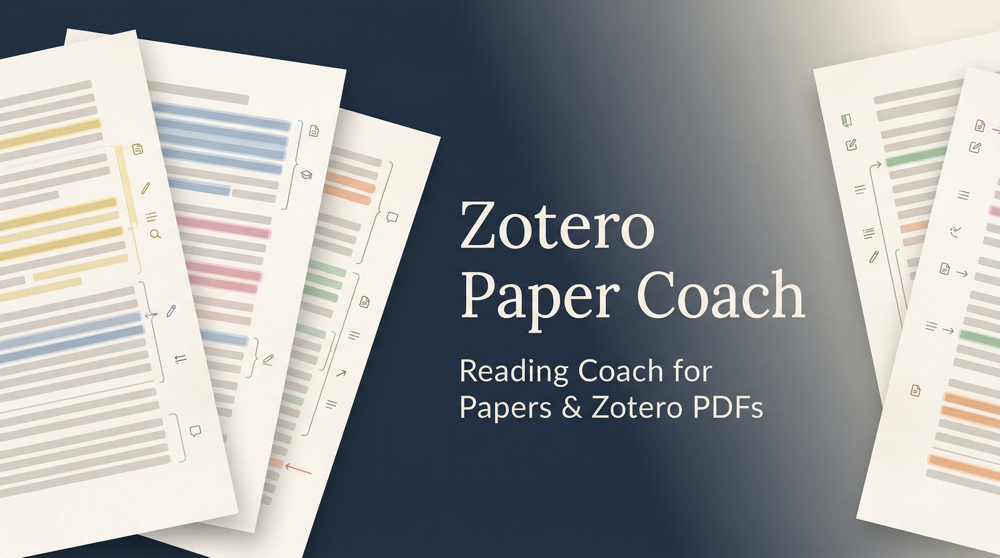
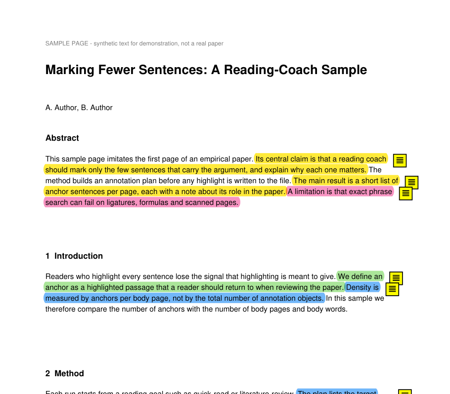
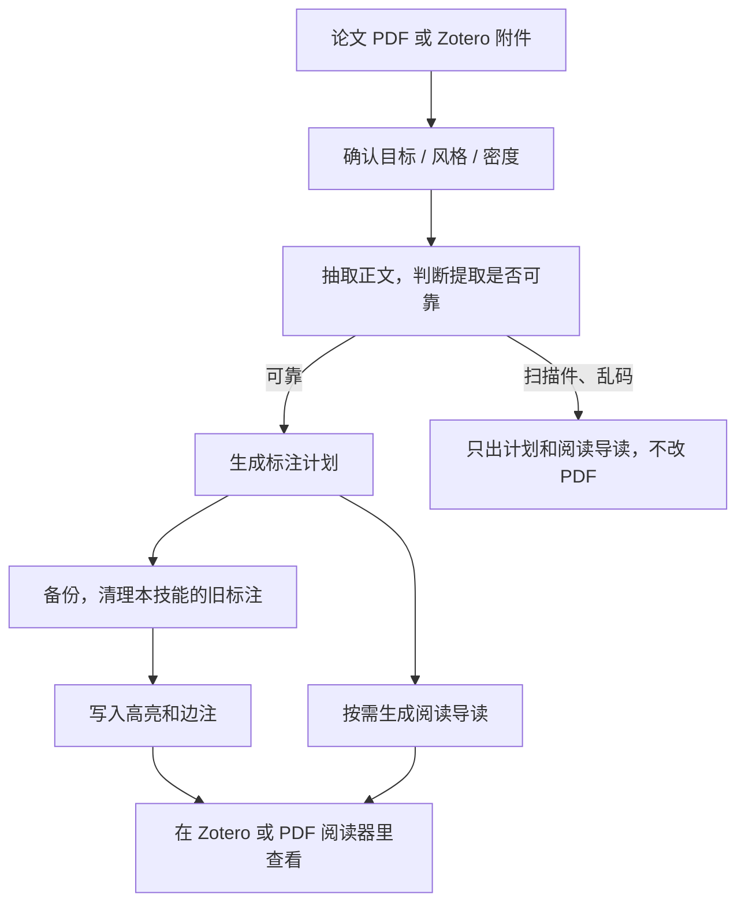

# 🧠 Zotero Paper Coach

让你的 AI Agent 按阅读目标给论文 PDF 画重点、写导师式边注，标注写进 PDF，在 Zotero 里直接看。

<p align="center">
  
</p>

## 🔍 实际效果



上图是 Codex 装好本技能后，收到一句「用 quick-read 模式标注这篇论文」自己完成的：读正文、挑出 6 句、配色、写边注、写回 PDF。三条边注原文：

> **[主张]** 这是摘要中的核心判断：标注应突出论证骨干，并说明每处标注的作用。
> **[限制]** 精确文本匹配受连字、公式和扫描页影响；遇到这些内容时，锚点可靠性会下降。
> **[定义]**「锚点」指复读时值得返回的高亮段落，不是所有被标记的文字。

输入是一页合成的示例稿，不是真实论文。〔待补：真实论文的标注截图〕

## 📌 状态与限制

- **能用在哪**：任何加载 Agent Skills 的 Agent。已实测 Codex（Windows 11，从 `.agents/skills` 自动加载并完成标注）；Claude Code 已按本技能完成标注，自动加载待在新会话中确认。2026-10 起改为通用技能，此前只支持 OpenClaw。
- **写在哪**：标注写进 PDF 文件本身，不是 Zotero 数据库里的原生注释；写之前先备份原件。默认只清理本技能写过的标注，你自己的标注不动。
- **不适合**：扫描件或 OCR 质量差的 PDF（只出阅读导读和标注计划，不改 PDF）；必须用 Zotero 原生注释的场景。
- **依赖**：Python 3 和 PyMuPDF；缺依赖时 Agent 先问你，不会自行安装。脚本已在 Windows 11、Python 3.13、PyMuPDF 1.25.3 上测试，最初在 macOS 上开发。
- **数据去向**：脚本不联网、不需要凭据；导入 Zotero 时只连本机 `127.0.0.1:23119`。Agent 读论文时，正文会进入你所用模型的上下文。

## 📦 安装

**推荐**：把这句话发给你的 Agent，它会按 [`docs/install.md`](./docs/install.md) 装到正确的位置。

```text
帮我安装 Zotero Paper Coach：https://raw.githubusercontent.com/RZX00/zotero-paper-coach/main/docs/install.md
```

手动安装：把仓库里的 `zotero-paper-coach/` 文件夹整个复制到你的 Agent 的技能目录。

| Agent | 技能目录 |
|---|---|
| Claude Code | `~/.claude/skills/` |
| Codex | `~/.agents/skills/` |

复制完，`SKILL.md` 应该在 `<技能目录>/zotero-paper-coach/SKILL.md`。Codex 会自动发现新技能；Claude Code 如果是第一次装技能，运行 `/reload-skills`。

## 🚀 第一次使用

对 Agent 说：

```text
用 quick-read 模式标注这篇论文：~/Zotero/storage/ABCD1234/paper.pdf
```

它会：

1. 确认你没说的配置；没有特别要求时用默认值（mentor 风格、medium 密度）。
2. 备份 PDF，再把高亮和边注写进原文件。
3. 按需另存阅读导读和标注计划：`paper.reading-guide.md`、`paper.annotation-plan.md`、`paper.annotation-plan.json`。

<details>
<summary>不经过 Agent，只跑写回脚本</summary>

脚本会原地修改 PDF，先复制一份。Windows 上把 `python3` 换成 `python`。

```bash
cp docs/demo/sample-paper.pdf demo.pdf
python3 zotero-paper-coach/scripts/annotate_pdf.py demo.pdf docs/demo/sample-highlights.json --backup
# 输出 12：6 处高亮 + 6 条边注；demo.pdf.bak-paper-coach 是原件备份
```

[`sample-highlights.json`](./docs/demo/sample-highlights.json) 就是上图那次运行的标注计划，[`sample-paper.annotated.pdf`](./docs/demo/sample-paper.annotated.pdf) 是结果。

</details>

## 🆚 和逐句自动高亮比，差在哪

下表对比的是一种做法，不是某个具体产品。

| | 逐句自动高亮 | 本技能 |
|---|---|---|
| 标什么 | 见句就划 | 先按阅读目标挑句子；例如 `quick-read` 优先标摘要核心句、贡献、3 到 8 句最强的结果、主要局限和结论 |
| 颜色 | 没有固定含义 | 固定 5 色：黄 = 核心主张，蓝 = 证据和方法，粉 = 限制，绿 = 定义，橙 = 可引用句 |
| 边注 | 「important」 | 带标签的短边注，如 `[主张]` `[证据]` `[限制]` `[人话]`，说明这段在文中的作用 |
| 数量 | 固定条数 | 按正文页数、词数和段落密度估算，分 4 档 |
| 改文件 | 直接覆盖 | 先备份；默认只清理自己写的标注 |

## 🛠️ 能力与工作原理



先出标注计划，再动 PDF；计划是核心产物，高亮只是它的一种输出（见 [`DESIGN.md`](./zotero-paper-coach/DESIGN.md)）。读论文、挑句子、写边注由 Agent 完成；抽取文本、写入和清理标注、导入 Zotero 由 `scripts/` 里的四个 Python 脚本完成。

### 配置项

| 配置项 | 可选值 | 默认 |
|---|---|---|
| `goal` 阅读目标 | `beginner-learning` 入门理解、`quick-read` 快速抓重点、`exam-prep` 备考、`literature-review` 文献综述、`replication` 复现实验、`citation-harvest` 提取可引用观点 | `beginner-learning` |
| `style` 风格 | `mentor` 导师型、`top-student` 学霸型、`critical-researcher` 批判型研究员、`executive-brief` 极简摘要官 | `mentor` |
| `density` 密度 | `light`、`medium`、`heavy`、`teaching` | `medium` |
| `note depth` 边注深度 | `brief`、`explain`、`teach` | `explain` |
| `color scheme` 配色 | `standard`、`minimal`、`research` | `standard` |
| `rewrite mode` 重写方式 | `clean-coach-only` 只清理本技能的旧标注、`append` 保留旧标注追加、`wipe-all` 清空全部标注（需你确认） | `clean-coach-only` |

标注数量按高亮锚点计，不按「高亮 + 边注」的总数计；估算方法见 [`density-profiles.md`](./zotero-paper-coach/references/density-profiles.md)。

### 在 Zotero 里查看

- 直接改附件：写入 Zotero 存储目录里的 PDF，在 Zotero 里重新打开该附件即可看到。
- 导入一份副本：`scripts/import_pdf_to_zotero.py` 通过本机 Zotero 连接器把标注好的 PDF 作为新附件导入当前选中的文库或分类，需要 Zotero 桌面端正在运行。macOS 上不要用 `open -a Zotero file.pdf` 导入（原因见 [`zotero-import-workflow.md`](./zotero-paper-coach/references/zotero-import-workflow.md)）。

## 📁 仓库内容

```text
zotero-paper-coach/            要安装的技能目录
├── SKILL.md
├── DESIGN.md
├── references/                8 个参考文件
└── scripts/
    ├── extract_pdf_outline.py   抽取每页文本
    ├── annotate_pdf.py          把高亮和边注写进 PDF
    ├── remove_coach_annots.py   清理本技能写的标注
    └── import_pdf_to_zotero.py  经 Zotero 连接器导入 PDF
zotero-paper-coach.skill       技能目录的 zip 打包
docs/install.md                给 Agent 读的安装说明
docs/demo/                     示例 PDF、标注计划和结果
PROMPT_TEMPLATE.txt            安装提示词
```

## 📄 许可证

MIT，详见 [`LICENSE`](./LICENSE)。
